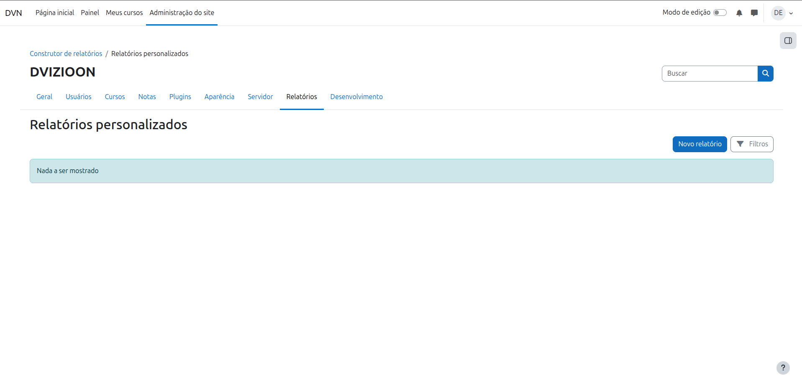
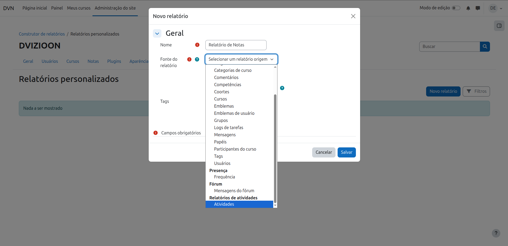
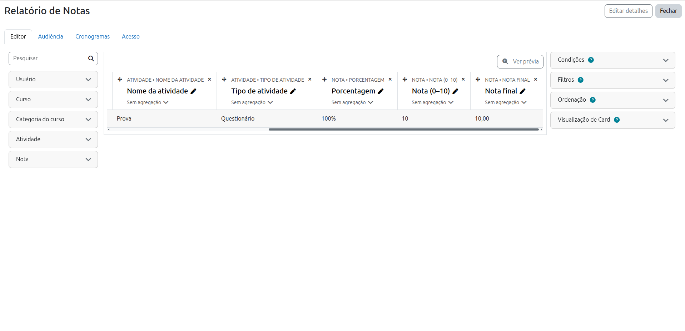
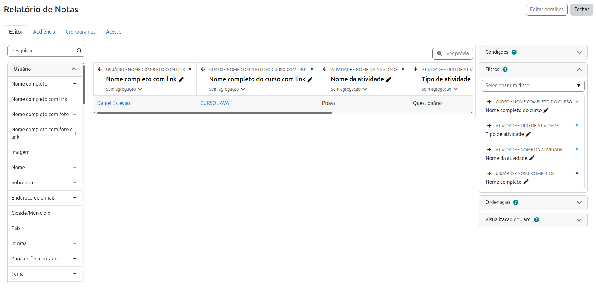
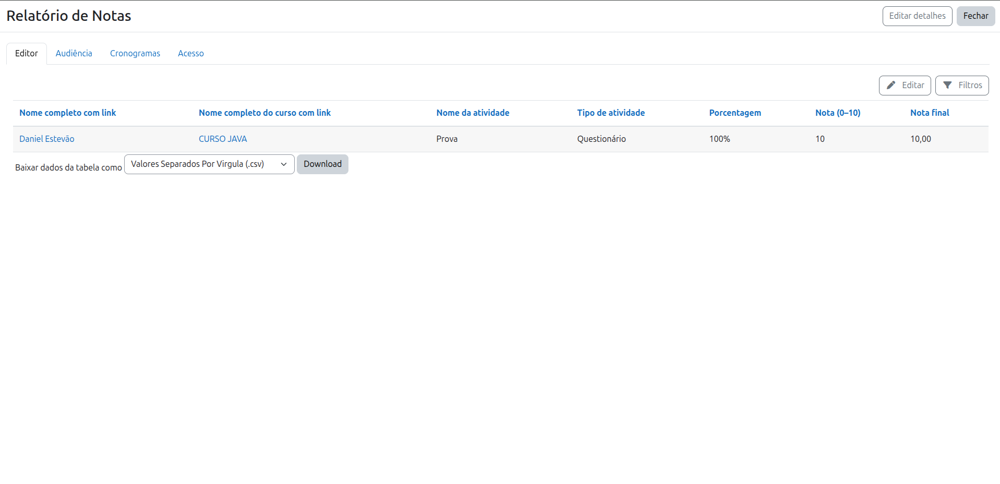

<div align="center">
  
</div>

<br />

<h1 align="center">MOODLE REPORT ACTIVITIES</h1>

<p align="center">
  Fonte do <strong>Report Builder</strong> para Moodle 5.2<br />
  Aluno · Curso · Tipo de atividade · Nota da atividade · Nota final do caderno · % · Nota 0–10
</p>

<p align="center">
  
  
  
  <br />
  
  
  
  
</p>

<p align="center">
  <a href="https://github.com/dvizioon/MOODLE_REPORT_ACTIVITY">Repositório</a> ·
  <a href="https://github.com/dvizioon/MOODLE_REPORT_ACTIVITY/issues">Issues</a> ·
  <a href="mailto:danielmartinsjob@gmail.com">Contato</a>
</p>

---

## O que é este plugin?

O Moodle já tem o **Construtor de Relatórios (Report Builder)**. Este plugin **não inventa outra tela de relatório** — ele **encaixa uma fonte de dados nova** chamada **Activities / Atividades**.

Assim você monta relatórios personalizados com:

| Contexto | Exemplos de campos |
|----------|-------------------|
| **Usuário** | Nome, e-mail, matrícula, campos de perfil |
| **Curso** | Nome, shortname, categoria |
| **Atividade** | Nome da atividade, tipo (Questionário, Tarefa…), nota máx/mín do item |
| **Nota** | Nota bruta da atividade, **nota final no caderno**, %, nota 0–10, feedback |

> [!IMPORTANT]
> Tudo roda **dentro do Report Builder** (`/reportbuilder/index.php`): colunas, filtros, audiência, agendamento e exportação CSV/Excel já são do Moodle. O plugin só entrega a **fonte** certa.

---

## Como funciona (bem explícito)

```text
┌─────────────────┐     cria item      ┌──────────────────┐
│  Atividade      │ ───────────────►   │  Caderno de      │
│  (quiz, assign…)│                    │  notas           │
│                 │   rawgrade         │  grade_items     │
│  Nota do módulo │ ───────────────►   │  grade_grades    │
└─────────────────┘                    └────────┬─────────┘
                                                │
                                                ▼
                                       ┌──────────────────┐
                                       │ Report Builder   │
                                       │ fonte Activities │
                                       │ report_activities│
                                       └──────────────────┘
```

1. O aluno faz a atividade (ex.: questionário).
2. O módulo manda a nota para o **caderno de notas**.
3. O caderno guarda:
   - **item de nota** daquela atividade (`grade_items`, `itemtype = mod`)
   - **nota do aluno** naquele item (`grade_grades`)
4. O plugin lê isso e disponibiliza no Report Builder.

### Nota da atividade × Nota final (caderno)

| Campo no relatório | O que é de verdade | Tabela Moodle |
|--------------------|--------------------|---------------|
| **Nota bruta** (`rawgrade`) | Nota que o **módulo** enviou (valor cru da atividade) | `grade_grades.rawgrade` |
| **Nota final** (`finalgrade`) | Nota **oficial no caderno de notas** daquele item — depois de normalização, override do professor, exclusão, etc. | `grade_grades.finalgrade` |
| **Porcentagem** | Quanto a nota final representa entre min e max do item | calculado |
| **Nota (0–10)** | A mesma proporção em escala 0–10, arredondada | calculado |

> [!IMPORTANT]
> **Nota final = nota dele no caderno de notas** para **aquela atividade** (aquele item de nota).  
> Não é o “total do curso” com todos os pesos somados. O total do curso é outro item (`itemtype = course`) e **não** entra nesta fonte.

> [!NOTE]
> Se o professor **sobrescrever** a nota no livro de notas, a **Nota final** reflete o caderno. A **Nota bruta** continua mostrando o que veio do módulo.

### Quais atividades entram?

Todas que têm **item de nota** no caderno (`itemtype = mod`):

- Questionário, Tarefa, Fórum (se avaliado), Lição, Workshop, SCORM…
- **Qualquer plugin `mod_*` novo** que grave nota — aparece sozinho

**Não entram:** página, arquivo, URL, rótulo (sem nota); totais de categoria; total do curso.

---

## Screenshots

<p align="center">
  
  <br /><em>1 — Entrar no Construtor de Relatórios (Report Builder)</em>
</p>

<p align="center">
  
  <br /><em>2 — Escolher a fonte <strong>Atividades</strong> / <strong>Activities</strong></em>
</p>

<p align="center">
  
  <br /><em>3 — Contextos: usuário, curso, atividade e nota</em>
</p>

<p align="center">
  
  <br /><em>4 — Editor: montar colunas, filtros e agregações</em>
</p>

<p align="center">
  
  <br /><em>5 — Visualizar / exportar o relatório</em>
</p>

---

## Links

- [Repositório](https://github.com/dvizioon/MOODLE_REPORT_ACTIVITY)
- [Issues / bug tracker](https://github.com/dvizioon/MOODLE_REPORT_ACTIVITY/issues)

---

## Funcionalidades

- **Integração Report Builder** — fonte nativa, sem tela paralela.
- **Uma linha = aluno × atividade com nota** no caderno.
- **Nota bruta** (módulo) + **nota final** (caderno).
- **Porcentagem** e **nota 0–10** (half-up: `7.3→7`, `7.5→8`).
- **Filtros / condições / audiência / cronogramas** do próprio Moodle.
- **Multi-idioma:** EN + pt_BR.
- **Privacy null provider** — não armazena dados extras.

## Campos de nota (detalhe)

| Campo | Origem | Uso típico |
|-------|--------|------------|
| **Nota bruta** | Atividade → caderno (`rawgrade`) | “O que o módulo tirou” |
| **Nota final** | Caderno de notas (`finalgrade`) | “O que vale no livro de notas daquela atividade” |
| **Nota máxima / mínima** | Item de nota (`grademax` / `grademin`) | Escala do item |
| **Porcentagem** | `((final − min) / (max − min)) × 100` | Ex.: `73%` |
| **Nota (0–10)** | Mesma proporção × 10, arredondada | Exibição pedagógica rápida |
| **Feedback** | Caderno | Comentário do professor |

Pesos de categoria e **total do curso** ficam fora desta fonte (de propósito: o relatório é por atividade).

## Tecnologias / API Moodle

- **Moodle 5.2** — `public/report/…`
- **core_reportbuilder** — datasource + entities
- **Gradebook** — `grade_items` / `grade_grades`
- **Entidades core** — `user`, `course`, `course_category`

## Estrutura do Projeto

```bash
activities/
│
├── version.php                 # report_activities · 1.3.0
├── settings.php                # Link admin → Report builder
├── index.php                   # Redirect → /reportbuilder/
├── README.md
├── db/
│   └── access.php              # report/activities:view
├── classes/
│   ├── privacy/
│   │   └── provider.php        # null_provider
│   └── reportbuilder/
│       ├── datasource/
│       │   └── activities.php  # Fonte "Activities"
│       └── local/entities/
│           ├── grade_item.php  # Atividade (nome, tipo, max/min)
│           └── grade.php       # Nota bruta, final, %, 0–10, feedback
├── lang/
│   ├── en/report_activities.php
│   └── pt_br/report_activities.php
└── screenshots/
    ├── entrarRelatorio.png
    ├── escolherAtividade.png
    ├── contextosRelatorio.png
    ├── visaoRelatorio.png
    └── vizualizarRelatorio.png
```

## Instalação

### Via Git (recomendado)

```bash
cd /caminho/do/moodle/public/report
git clone https://github.com/dvizioon/MOODLE_REPORT_ACTIVITY.git activities
```

Depois: **Administração do site → Notificações** (ou `php admin/cli/upgrade.php`).

### Via ZIP

1. O ZIP deve descompactar na pasta `activities/` (com `version.php` dentro).
2. **Não** faça upload de ZIP por cima se a pasta `report/activities` já existir — use Notificações.
3. Ou copie a pasta manualmente para `public/report/activities` e rode o upgrade.

### Uso rápido

1. Abra `/reportbuilder/index.php`
2. **Novo relatório** → fonte **Atividades** / **Activities**
3. Monte colunas (usuário, curso, atividade, nota bruta, **nota final**…), filtros e agendamentos

| Recurso | Caminho |
|---------|---------|
| Construtor | `/reportbuilder/index.php` |
| Plugin | `public/report/activities` |
| Componente | `report_activities` |

---

## Roadmap

### Feito (v1.3.0)

- [x] Fonte **Activities** no Report Builder (Moodle 5.2)
- [x] Contextos: usuário, curso, categoria, atividade, nota
- [x] **Nota bruta** (atividade) + **nota final** (caderno de notas)
- [x] Porcentagem e nota 0–10 (arredondamento half-up)
- [x] Filtros por curso, tipo de atividade, usuário
- [x] Lang EN + pt_BR
- [x] Privacy null provider
- [x] Screenshots + README

### Próximos passos (ideias)

- [ ] Coluna opcional de **peso do item** / categoria (ainda por atividade, sem total do curso)
- [ ] Opção de incluir **total do curso** (`itemtype = course`) como fonte separada ou coluna extra
- [ ] Filtro rápido “só questionários” / “só tarefas” no setup padrão
- [ ] Testes PHPUnit / Behat do datasource
- [ ] Suporte declarado a mais versões Moodle (5.1 / 5.3) após validação
- [ ] Documentação em vídeo (criar relatório do zero → exportar CSV)

Sugestões e bugs: [Issues](https://github.com/dvizioon/MOODLE_REPORT_ACTIVITY/issues).

---

## Privacidade

Null provider — o plugin **não grava** dados pessoais. Só lê tabelas já existentes (`user`, `course`, `grade_*`).

## Testes

### PHPUnit (recomendado)

Do diretório raiz do Moodle (onde está o `phpunit.xml`):

```bash
# Inicializar PHPUnit uma vez (se ainda não fez)
php admin/tool/phpunit/cli/init.php

# Rodar só os testes deste plugin
vendor/bin/phpunit --testsuite report_activities_testsuite
# ou pelo caminho:
vendor/bin/phpunit public/report/activities/tests/reportbuilder/datasource/activities_test.php
```

Cobre: fonte disponível no Report Builder, colunas padrão, nota final / % / 0–10.

### Behat

```bash
# Inicializar Behat (uma vez)
php admin/tool/behat/cli/init.php

# Rodar features deste plugin
php admin/tool/behat/cli/run.php --tags=@report_activities
```

Cobre: criar relatório customizado com fonte **Activities** na UI.

Arquivos:

```
tests/
├── reportbuilder/datasource/activities_test.php   # PHPUnit
└── behat/activities_report.feature                # Behat
```

## Contato

Dúvidas e suporte: [danielmartinsjob@gmail.com](mailto:danielmartinsjob@gmail.com)

**Créditos:** Desenvolvido por Daniel Estevão · **DVIZIOON**

## Licença

[](https://www.gnu.org/licenses/gpl-3.0)

Plugin Moodle — **GNU GPL v3 or later** (mesmo license do Moodle).

## Changelog

### 1.3.0 (`2026092303`)

- Frankenstyle `report_activities` (inglês).
- Fonte Report Builder: **Activities**.
- Nota bruta (atividade) + nota final (caderno), %, escala 0–10.
- Lang packs EN + pt_BR.
- Screenshots, README explícito e roadmap.
