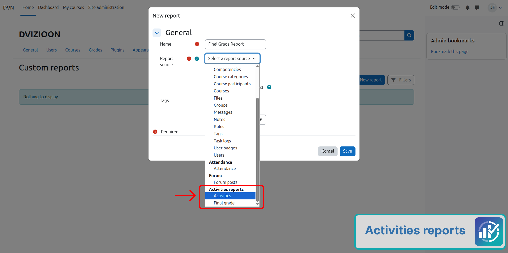
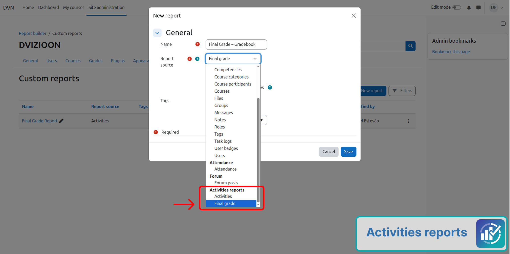
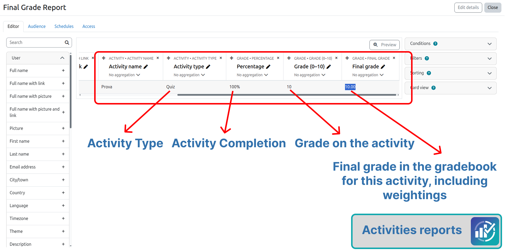
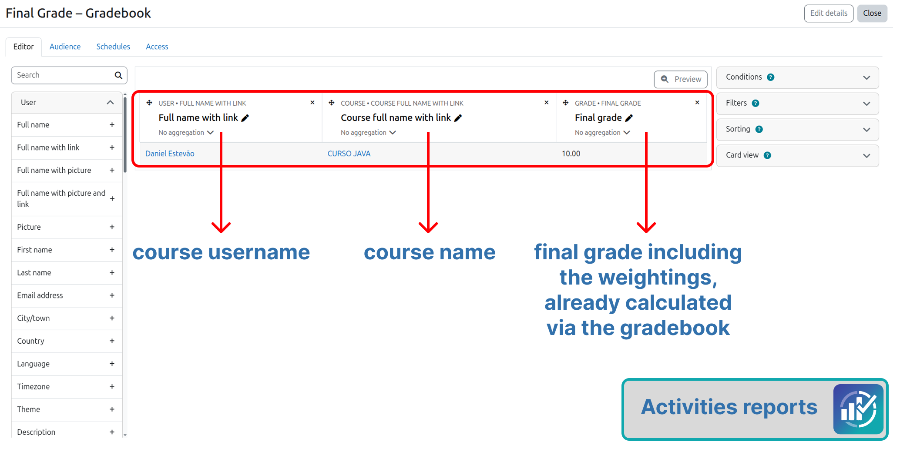
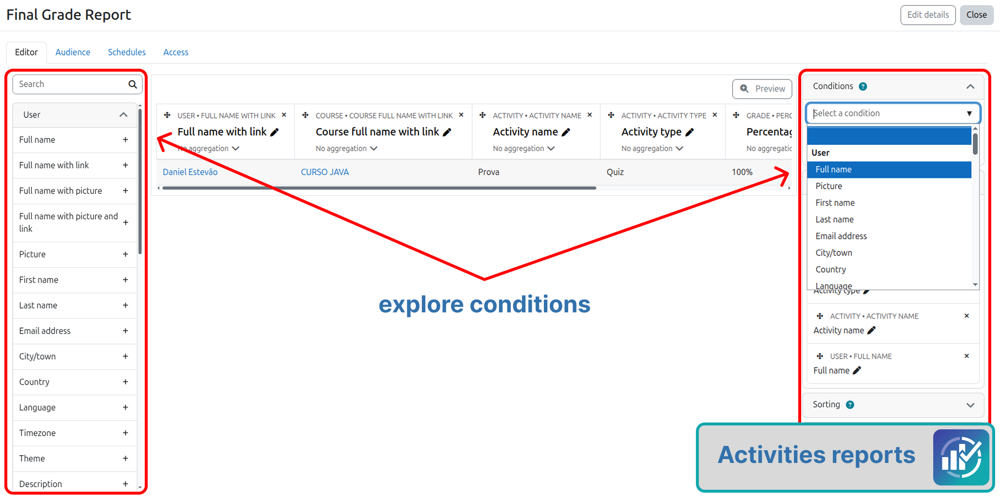
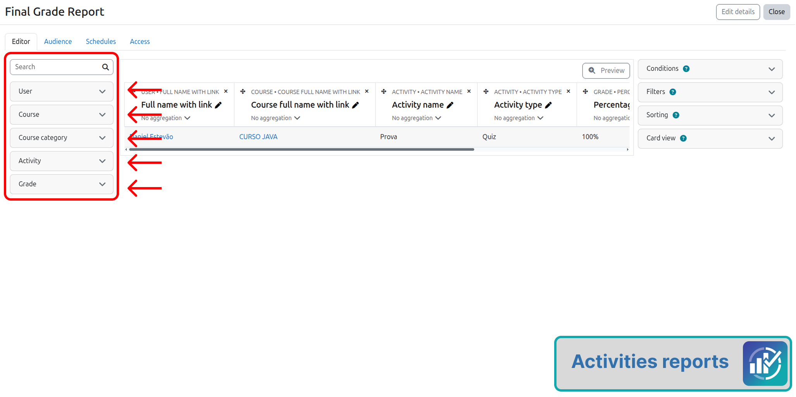
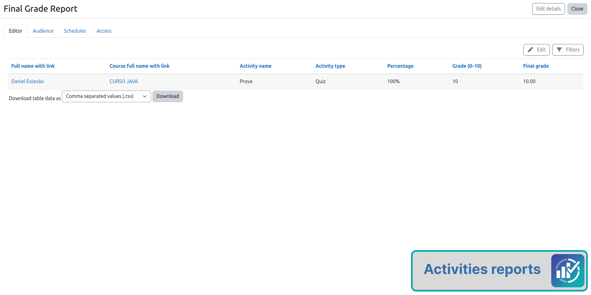

<div align="center">
  
</div>

<br />

<h1 align="center">MOODLE REPORT ACTIVITIES</h1>

<p align="center">
  <strong>Report Builder</strong> data source for Moodle 5.2<br />
  User · Course · Activity type · Activity grade · Course final grade · % · Grade 0–10
</p>

<p align="center">
  
  
  
  <br />
  
  
  
  
</p>

<p align="center">
  <strong>English</strong> ·
  <a href="README.pt_br.md">Português (Brasil)</a> ·
  <a href="mailto:danielmartinsjob@gmail.com">Contact</a>
</p>

---

## What is this plugin?

Moodle already has the **Report Builder**. This plugin does **not** invent another report screen — it adds Report Builder data sources: **Activities** and **Final grade**.

You can build custom reports with:

| Context | Example fields |
|---------|----------------|
| **User** | Name, email, ID number, profile fields |
| **Course** | Name, short name, category |
| **Activity** | Activity name, type (Quiz, Assignment…), item grade max/min |
| **Grade** | Activity raw grade, **gradebook final grade**, %, grade 0–10, feedback |

> [!IMPORTANT]
> Everything runs **inside Report Builder** (`/reportbuilder/index.php`): columns, filters, audience, schedules and CSV/Excel export are core Moodle. The plugin only supplies the **data sources**.

---

## How it works

```text
┌─────────────────┐     creates item   ┌──────────────────┐
│  Activity       │ ───────────────►   │  Gradebook       │
│  (quiz, assign…)│                    │                  │
│                 │   rawgrade         │  grade_items     │
│  Module grade   │ ───────────────►   │  grade_grades    │
└─────────────────┘                    └────────┬─────────┘
                                                │
                                                ▼
                                       ┌──────────────────┐
                                       │ Report Builder   │
                                       │ Activities source│
                                       │ report_activities│
                                       └──────────────────┘
```

1. The student completes an activity (e.g. a quiz).
2. The module sends the grade to the **gradebook**.
3. The gradebook stores:
   - a **grade item** for that activity (`grade_items`, `itemtype = mod`)
   - the **student grade** on that item (`grade_grades`)
4. The plugin reads that data and exposes it in Report Builder.

### Activity grade × course final grade

| Report field | What it really is | Moodle table |
|--------------|-------------------|--------------|
| **Raw grade** (`rawgrade`) | Grade sent by the **module** (raw activity value) | `grade_grades.rawgrade` |
| **Final grade** (`finalgrade`) | Official **gradebook** value for that item — after normalisation, teacher override, exclusion, etc. | `grade_grades.finalgrade` |
| **Percentage** | How the final grade sits between item min and max | computed |
| **Grade (0–10)** | Same ratio on a 0–10 scale, rounded | computed |

> [!IMPORTANT]
> **Activities** reads each activity grade (`itemtype = mod`).
> **Final grade** (another source in the same plugin group) reads the course gradebook total (`itemtype = course`), with formula and aggregation already applied — the stored value; it does not recalculate weights by itself.

> [!NOTE]
> If a teacher **overrides** a grade in the gradebook, **Final grade** follows the gradebook. **Raw grade** still shows what the module sent.

### Which activities are included?

All activities that have a **grade item** in the gradebook (`itemtype = mod`):

- Quiz, Assignment, Forum (if graded), Lesson, Workshop, SCORM…
- **Any new `mod_*` plugin** that writes grades — it appears automatically

**Not included as rows:** Page, File, URL, Label (no grade); category totals. The course total is available through the **Final grade** source.

---

## Screenshots

Screenshots from version **1.3.6** (`screenshots/1.3.6/`).

### Create a report from the Activities source

Goal: open Report Builder and start a custom report using **Activities** (grades per activity).

<p align="center">
  
  <br /><em>New report dialogue with source Activities</em>
</p>

### Create a report from the Final grade source

Goal: start a custom report using **Final grade** (course gradebook total).

<p align="center">
  
  <br /><em>New report dialogue with source Final grade</em>
</p>

### Grades by activity

Goal: view student grades for each graded activity (user, course, activity, percentage, final grade).

<p align="center">
  
  <br /><em>Report built from the Activities source</em>
</p>

### Course final grades

Goal: view the course total already calculated in the gradebook (weights and aggregation applied).

<p align="center">
  
  <br /><em>Report built from the Final grade source</em>
</p>

### Conditions

Goal: limit who appears in the report (for example by course or user).

<p align="center">
  
  <br /><em>Conditions panel in the report editor</em>
</p>

### Access

Goal: control who can view the custom report.

<p align="center">
  
  <br /><em>Access tab for the custom report</em>
</p>

### Card / grid view

Goal: present the same data in a card layout when preferred.

<p align="center">
  
  <br /><em>Card view of report results</em>
</p>

---

## Links

- [Repository](https://github.com/dvizioon/MOODLE-REPORT-ACTIVITIES)
- [Issues / bug tracker](https://github.com/dvizioon/MOODLE-REPORT-ACTIVITIES/issues)

---

## Features

- **Report Builder integration** — native source, no parallel UI.
- **One row = student × graded activity** in the gradebook.
- Separate **Final grade** source for the course total.
- **Raw grade** (module) + **final grade** (gradebook).
- **Percentage** and **grade 0–10** (half-up: `7.3→7`, `7.5→8`).
- Moodle **filters / conditions / audience / schedules**.
- **Multi-language:** EN + pt_BR.
- **Privacy null provider** — stores no extra data.
- **Tests:** PHPUnit + Behat (`@report_activities`).

## Grade fields (detail)

| Field | Source | Typical use |
|-------|--------|-------------|
| **Raw grade** | Activity → gradebook (`rawgrade`) | “What the module scored” |
| **Final grade** | Gradebook (`finalgrade`) | “What counts in the gradebook for that activity” |
| **Grade max / min** | Grade item (`grademax` / `grademin`) | Item scale |
| **Percentage** | `((final − min) / (max − min)) × 100` | e.g. `73%` |
| **Grade (0–10)** | Same ratio × 10, rounded | Quick teaching display |
| **Feedback** | Gradebook | Teacher comment |

## Technologies / Moodle API

- **Moodle 5.2** — `public/report/…`
- **core_reportbuilder** — datasource + entities
- **Gradebook** — `grade_items` / `grade_grades`
- **Core entities** — `user`, `course`, `course_category`

## Project structure

```bash
activities/
│
├── version.php                 # report_activities · 1.3.7
├── settings.php                # Admin link → Report builder
├── index.php                   # Redirect → /reportbuilder/
├── LICENSE
├── README.md
├── README.pt_br.md
├── pix/
│   ├── logo.png / logo.svg     # Marketplace / README
│   └── monologo.svg            # Moodle monochrome icon
├── db/
│   └── access.php              # report/activities:view
├── classes/
│   ├── privacy/
│   │   └── provider.php        # null_provider
│   └── reportbuilder/
│       ├── datasource/
│       │   ├── activities.php  # "Activities" source
│       │   └── coursefinal.php # "Final grade" source
│       └── local/entities/
│           ├── grade_item.php  # Activity (name, type, max/min)
│           ├── grade.php       # Raw, final, %, 0–10, feedback
│           └── course_total.php
├── lang/
│   ├── en/report_activities.php
│   └── pt_br/report_activities.php
├── tests/
│   ├── reportbuilder/datasource/
│   │   ├── activities_test.php
│   │   └── coursefinal_test.php
│   └── behat/activities_report.feature
└── screenshots/
    ├── entrarRelatorio.png
    ├── escolherAtividade.png
    ├── contextosRelatorio.png
    ├── visaoRelatorio.png
    └── vizualizarRelatorio.png
```

## Installation

### Via Git (recommended)

On Moodle **5.2**, plugin code lives under `public/`:

```bash
cd /path/to/moodle/public/report
git clone https://github.com/dvizioon/MOODLE-REPORT-ACTIVITIES.git activities
```

Then: **Site administration → Notifications** (or from the Moodle root):

```bash
php public/admin/cli/upgrade.php
```

### Via ZIP

1. The ZIP must unpack into an `activities/` folder (with `version.php` inside).
2. **Do not** upload a ZIP over an existing `report/activities` folder — use Notifications.
3. Or copy the folder manually to `public/report/activities` and run the upgrade.

### Quick start

1. Open `/reportbuilder/index.php`
2. **New report** → source **Activities** or **Final grade**
3. Add columns (user, course, activity, raw grade, **final grade**…), filters and schedules

| Resource | Path |
|----------|------|
| Report builder | `/reportbuilder/index.php` |
| Plugin | `public/report/activities` |
| Component | `report_activities` |
| Frankenstyle | `report_activities` |

---

## Roadmap

### Done (v1.3.7)

- [x] **Activities** source in Report Builder (Moodle 5.2)
- [x] **Final grade** source (course gradebook total)
- [x] Contexts: user, course, category, activity, grade
- [x] **Raw grade** (activity) + **final grade** (gradebook)
- [x] Percentage and grade 0–10 (half-up rounding)
- [x] Filters by course, activity type, user
- [x] Lang EN + pt_BR
- [x] Privacy null provider
- [x] Screenshots + README
- [x] PHPUnit + Behat tests (`@report_activities`)

### Next ideas

- [ ] Optional **item weight** / category column (still per activity)
- [ ] Quick default filter “quizzes only” / “assignments only”
- [ ] Declared support for more Moodle versions after validation
- [ ] Video guide (create a report from scratch → export CSV)

Suggestions and bugs: [Issues](https://github.com/dvizioon/MOODLE-REPORT-ACTIVITIES/issues).

---

## Privacy

Null provider — the plugin **does not store** personal data. It only reads existing tables (`user`, `course`, `grade_*`).

## Tests

On Moodle **5.2**, CLIs live under `public/admin/…`. Always run from the Moodle root (where `config.php` and `vendor/` are).

### PHPUnit

```bash
# Initialise PHPUnit once (if needed)
php public/admin/tool/phpunit/cli/init.php

# This plugin only
vendor/bin/phpunit --testsuite report_activities_testsuite

# Or by file
vendor/bin/phpunit public/report/activities/tests/reportbuilder/datasource/activities_test.php
vendor/bin/phpunit public/report/activities/tests/reportbuilder/datasource/coursefinal_test.php
```

Covers: source available in Report Builder, default columns, final grade / % / 0–10.

### Behat

```bash
# Initialise Behat (once)
php public/admin/tool/behat/cli/init.php

# This plugin's features
php public/admin/tool/behat/cli/run.php --tags=@report_activities
```

Covers: creating a custom report with the **Activities** source in the UI.

Files:

```
tests/
├── reportbuilder/datasource/
│   ├── activities_test.php    # PHPUnit
│   └── coursefinal_test.php   # PHPUnit
└── behat/activities_report.feature
```

## Contact

Questions and support: [danielmartinsjob@gmail.com](mailto:danielmartinsjob@gmail.com)

**Credits:** Developed by Daniel Estevão · **DVIZIOON**

## License

[](https://www.gnu.org/licenses/gpl-3.0)

Moodle plugin — **GNU GPL v3 or later** (same license as Moodle).
