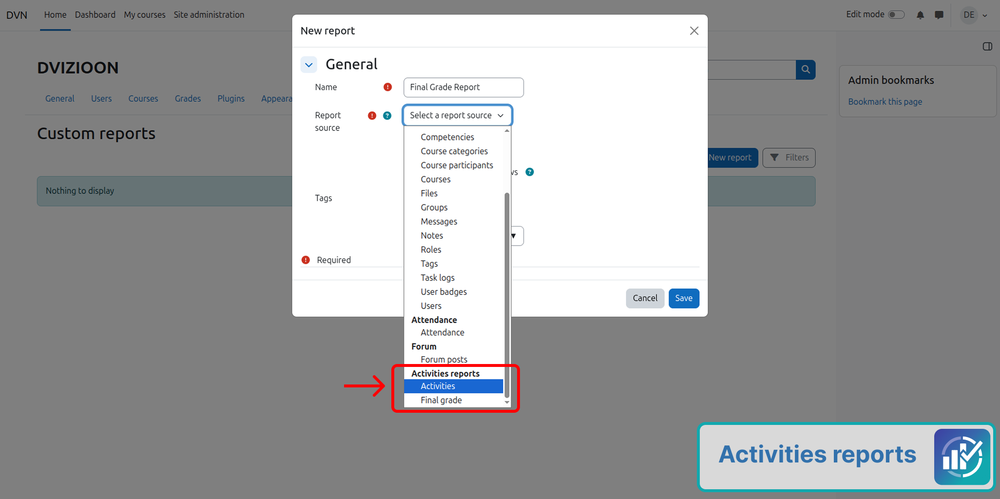
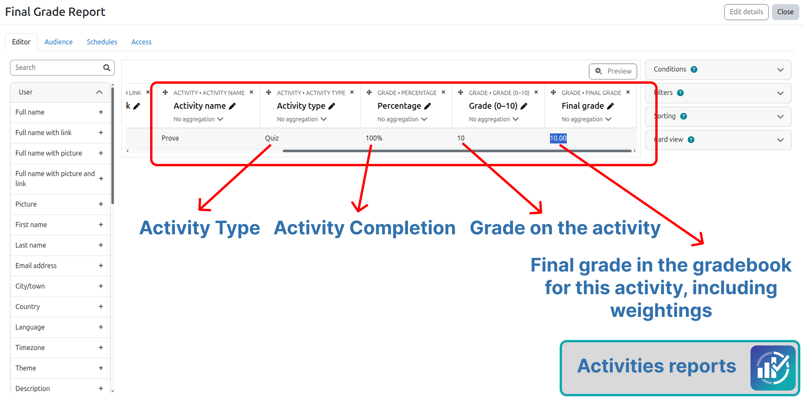
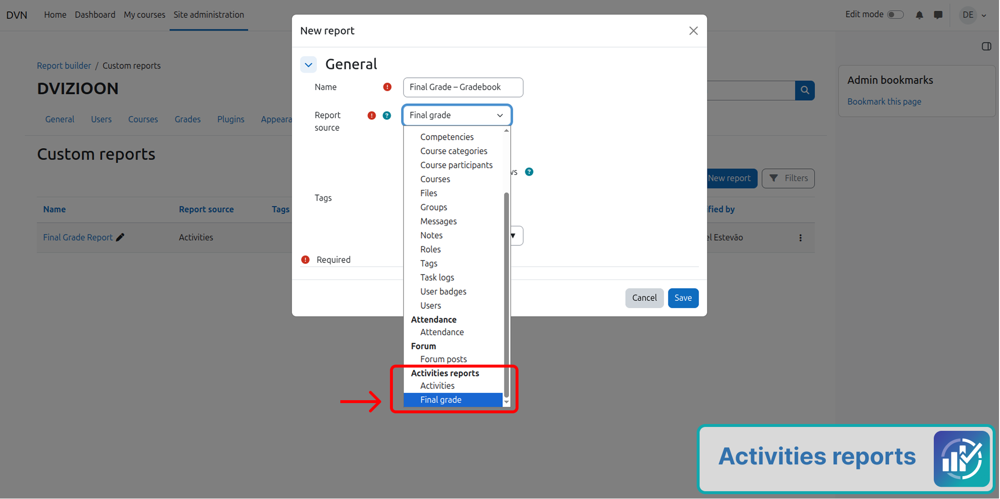
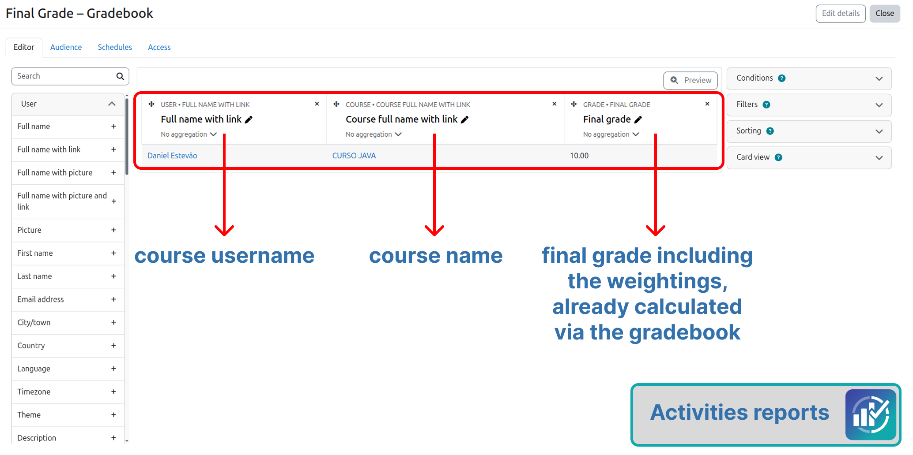

# Report sources

## Activities

Each row represents one student and one graded activity.

Characteristics:

- Uses gradebook items with module item type (`mod`)
- Covers quizzes, assignments, graded forums, lessons, workshops, SCORM and other activities that store grades
- Excludes resources without grades (page, file, URL, label)
- Does not use category totals as report rows
- The course total is provided by the **Final grade** source

Available fields include user, course, course category (Moodle 4.1 or later), activity name and type, raw grade, activity final grade, percentage, grade on a 0–10 scale, feedback and last modified date.

*Creating a report with the Activities source*

*Example report built with the Activities source*

## Final grade

Each row represents one student and one course.

Characteristics:

- Uses the course gradebook total
- Shows the same value as Course total in the grader report
- Respects weights, formulas and aggregation already applied by Moodle
- Does not recalculate the total in the plugin

Available fields include user, course, course category (Moodle 4.1 or later) and course final grade.

*Creating a report with the Final grade source*

*Example report built with the Final grade source*

## Which source to choose

| Goal | Recommended source |
|------|--------------------|
| Grades per activity | **Activities** |
| Course total only | **Final grade** |

Both sources appear in the Report Builder source selector, in the plugin group.
