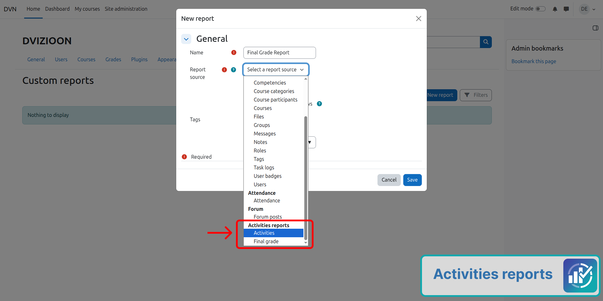
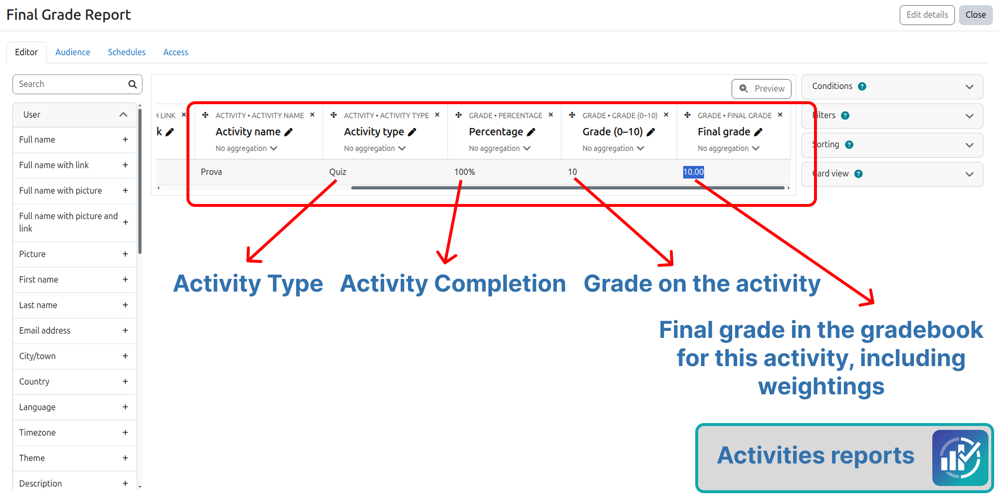
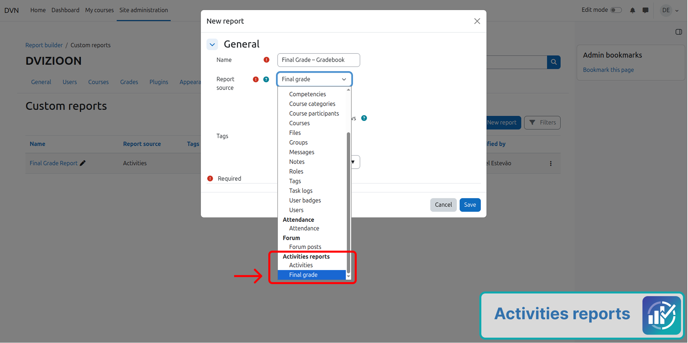
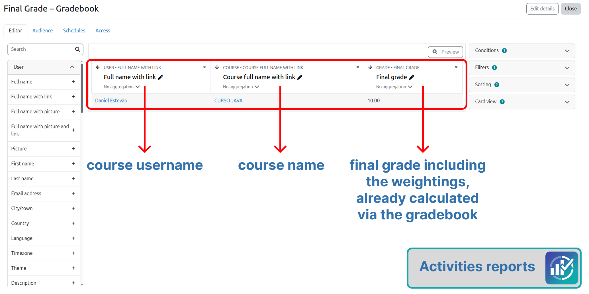

# Fontes de relatório

## 1. Atividades

Uma linha = **um aluno × uma atividade avaliada**.

- Usa itens do caderno com `itemtype = mod`
- Inclui Quiz, Tarefa, Fórum com nota, Lição, Workshop, SCORM e qualquer `mod_*` que grave nota
- **Não** lista Página, Arquivo, URL, Rótulo
- **Não** usa totais de categoria como linha
- O total do curso fica na outra fonte

Campos típicos: usuário, curso, categoria do curso (Moodle 4.1+), nome e tipo da atividade, nota bruta, nota final da atividade, %, nota 0–10, feedback, última modificação.

## 2. Nota final

Uma linha = **um aluno × um curso**.

- Usa o total do caderno (`itemtype = course`)
- Mesmo valor de **Total do curso** no relatório do avaliador
- Usa `grade_get_course_grades()` — pesos, fórmulas e agregação já aplicados
- O plugin **não** recalcula o total

Campos típicos: usuário, curso, categoria (4.1+), nota final do curso.

## Qual escolher?

| Objetivo | Fonte |
|----------|-------|
| Nota de cada Quiz / Tarefa | **Atividades** |
| Só o total do curso | **Nota final** |

As duas fontes ficam no mesmo grupo do plugin no seletor do Report Builder.
