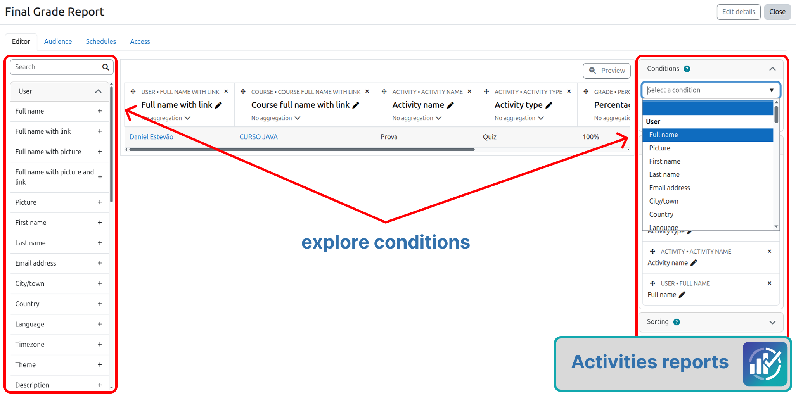
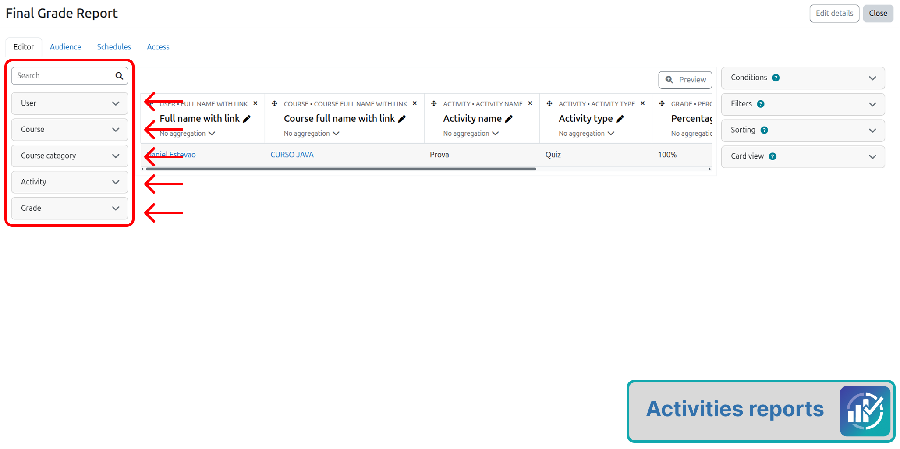
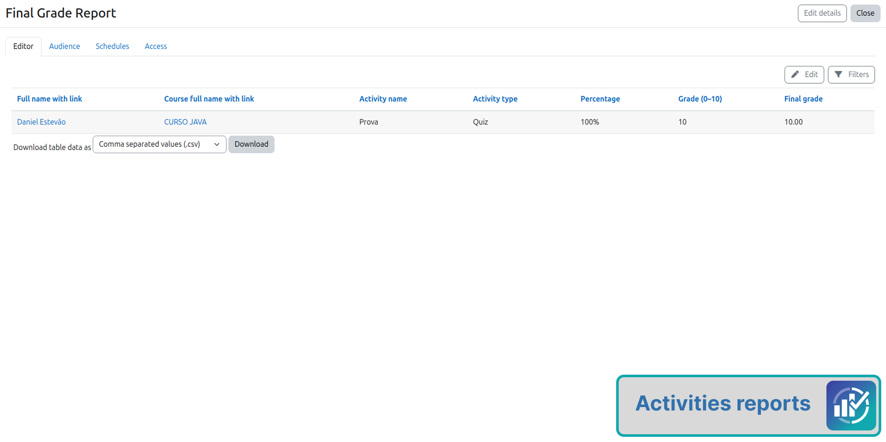

# Como usar

## Criar um relatório

1. **Administração do site / Relatórios / Construtor de relatórios / Relatórios personalizados**
2. **Novo relatório**
3. Escolha a fonte **Atividades** ou **Nota final**
4. Defina colunas, filtros e condições
5. Configure **Acesso** (audiência) e, se quiser, cronogramas e exportação

## Colunas padrão (Atividades)

Na criação, a fonte **Atividades** já sugere:

1. Nome completo do usuário (com link)
2. Nome completo do curso (com link)
3. Nome da atividade
4. Tipo da atividade
5. Porcentagem
6. Nota 0–10
7. Nota final da atividade

Você pode adicionar ou remover colunas depois.

## Filtros e condições

Use os filtros e condições do próprio Report Builder (curso, usuário, tipo de atividade, etc.) para limitar quem aparece.

## Capacidade

Sem `report/activities:view`, as duas fontes ficam ocultas (`is_available()` retorna falso).

## Entrada opcional do plugin

`index.php` do plugin exige login + a capacidade e redireciona para `/reportbuilder/index.php`. O fluxo principal continua sendo o menu do Construtor de Relatórios.
